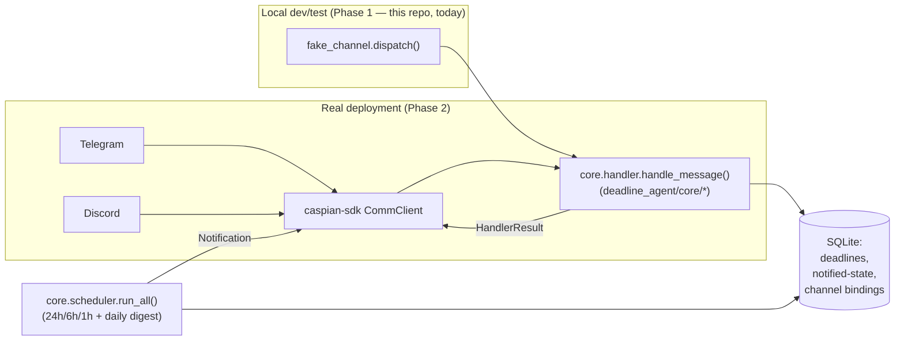

# Deadline

An agent that watches your open hackathon submission deadlines and reaches
you *before* you miss one — on whichever channel you're actually near.

Built for the **Caspian Buildathon**. Single judging criterion: *the most
creative use case that actually works.* This is the agent I actually want
running on my own phone, which is the brief.

## Why this exists

In the 36 hours before this was written, three real deadlines were missed
for the same reason every time — nothing pinged, so nothing was seen:

- **Arm Create** ($8,000 prize pool)
- **ML Empowerment** ($70,345 headline prize)
- **NEXORA Global**

Not "ran out of time to build." Not "didn't qualify." Missed because the
deadline lived in a tab, an email, a Devpost bookmark — somewhere that
requires *remembering to check it* — and nothing ever spoke up. Deadline
exists to be the thing that speaks up, on Telegram or Discord, wherever I
already am.

## Architecture: one handler, two channels

This is the part the SDK-usage judging actually checks: *"duplicating your
handler per channel doesn't count."* So it doesn't, here.



- **`deadline_agent/core/`** — the entire product: command parsing, the
  forgiving date parser, deadline CRUD, the 24h/6h/1h + daily-digest
  scheduler, SQLite persistence. **Zero imports of `caspian_sdk`, `discord`,
  or `telegram` anywhere in this directory** — not "avoided by convention,"
  mechanically enforced: `tests/test_architecture.py` parses the AST of
  every file in `core/` and fails the suite if one shows up.
- **`deadline_agent/adapters/caspian_app.py`** — the real Telegram + Discord
  wiring. It calls `client.connect_telegram(bot_token=...)` and
  `client.connect_discord(bot_token=...)` on **one** `CommClient`, registers
  **exactly one** `@client.on_message` handler (`register_handler()` —
  `tests/test_architecture.py` also greps its source and fails if that
  decorator appears more than once), and that handler's entire body is:
  turn Caspian's normalized `message` into an `InboundMessage`, call
  `core.handler.handle_message()`, reply with what comes back. Nothing
  channel-specific about deadlines lives here.
- **`deadline_agent/adapters/fake_channel.py`** — the local dev/test
  channel used for everything in Phase 1: same shape, same call into the
  same `handle_message()`. `tests/test_architecture.py` asserts
  `fake_channel.handle_message is caspian_app.handle_message is
  core.handler.handle_message` — literally the same function object, not
  three implementations that happen to agree.
- **`deadline_agent/core/scheduler.py`** — decoupled from every channel:
  it only knows about `Deadline` and `ChannelBinding` records in SQLite and
  produces `Notification(channel, conversation_id, text)` objects. The
  runtime loop (in `caspian_app.py`) is the only place that turns a
  `Notification` into a real `client.send_message(...)` call.

## Commands (identical on every channel)

```
/add <name> <date/time>   Track a new deadline. Dates are forgiving:
                           "17 Aug 9pm", "tomorrow 3am", "in 6 hours",
                           or a plain ISO timestamp all work.
/list                     Everything tracked, soonest first, time remaining.
/remove <name>             Stop tracking something (exact or partial match).
/help                      Command reference.
```

Anything that doesn't match one of the four shapes above falls back to a
help hint — or, if `FEATHERLESS_API_KEY` is set, gets one attempt at being
rewritten into a real command by an LLM first (see "Two-layer design"
below). Try: `hey remind me about impact forge, due in 2 days`.

### The `/add` name/date split

`/add` takes free text with no delimiter between the name and the date
("`/add CS Girlies 17 Aug 9pm`"). The parser tries the **longest possible
date phrase first** and shrinks it from the left, one token at a time,
until something parses — so `"CS Girlies 17 Aug 9pm"` correctly lands on
`name="CS Girlies"`, `when="17 Aug 9pm"`, not `name="CS Girlies 17 Aug"`,
`when="9pm"`. See `deadline_agent/core/commands.py`'s docstring for the
worked examples, and `tests/test_commands.py` for the coverage.

## Proactive behavior (the "agent" part)

- **24h / 6h / 1h alerts** before every tracked deadline.
- **Daily digest** (once per day, after 09:00 IST by default) summarizing
  everything still open.
- **Shared state across channels**: every inbound message — on either
  channel — upserts a `(channel, conversation_id)` binding in SQLite.
  Alerts fire to *every* known binding, so something added on Telegram
  shows up on `/list` from Discord, and both get pinged. This is what makes
  "one handler, two channels" real instead of cosmetic — see
  `tests/test_cross_channel.py`.
- **Restart-safe**: "already notified" is a row in SQLite
  (`notified_thresholds`, keyed by `(deadline_id, kind)`), written in the
  same call that decided to fire. A killed-and-restarted process (a brand
  new `Database` object pointed at the same file, in
  `tests/test_restart_survival.py`) never re-sends an alert that already
  went out.
- **Catch-up firing, on purpose**: if a deadline is added with, say, 45
  minutes left, the 24h and 6h trigger points are already behind "now" —
  so all three alerts fire together on the very next tick instead of being
  silently skipped. This is also the mechanism for proving a *live* alert
  works once real tokens exist: add a deadline a couple of minutes out and
  watch the next tick deliver it for real (see Phase 2 below).

## Two-layer design (deterministic core, AI strictly on top)

Every real command is handled entirely offline — `core/commands.py` and
`core/parser.py` need no network call and no API key. `core/ai_fallback.py`
is a small, *injected* extra: for text that matches none of the four
command shapes, it asks a Featherless-hosted model
(`deepseek-ai/DeepSeek-V3-0324` by default — the required inference
partner) to rewrite it into one, then the exact same deterministic parser
re-parses whatever comes back. If `FEATHERLESS_API_KEY` is unset, or the
call fails for any reason, it returns `None` and the product falls back to
the plain help hint — nothing about `/add`, `/list`, `/remove`, or the
scheduler depends on this layer existing.

## Setup

### 1. Caspian gateway

```bash
pip install caspian-sdk   # or: uv sync (already in pyproject.toml)
# Mint a free sandbox key — no sign-in needed for free channels:
curl -X POST https://api.trycaspianai.com/v1/projects/sandbox -d '{"name":"deadline-agent"}'
```

Put the returned `api_key` into `.env.local` as `CASPIAN_API_KEY`. (A real
one is already there for this submission — see "What's already wired up"
below.)

### 2. Telegram

Message [@BotFather](https://t.me/BotFather) on Telegram, `/newbot`, copy
the token into `.env.local` as `TELEGRAM_BOT_TOKEN`.

### 3. Discord

Create an application + bot at
[discord.com/developers/applications](https://discord.com/developers/applications) →
**Bot** → **Reset Token** → put it in `.env.local` as `DISCORD_BOT_TOKEN`.

> **Easy to miss, breaks everything silently if skipped:** on that same Bot
> page, under **Privileged Gateway Intents**, enable **MESSAGE CONTENT
> INTENT**. Without it, Discord never delivers message text to the bot —
> `/add` etc. arrive as empty strings and nothing happens, with no error
> anywhere. (Verified directly against Caspian's own gateway source: its
> Discord gateway listener requests intent bit 15, which is exactly
> `MESSAGE_CONTENT`, alongside `GUILD_MESSAGES` / `DIRECT_MESSAGES` /
> their reaction variants.)

Then invite the bot to a server with the `bot` scope and
`Send Messages` + `Read Message History` permissions.

### 4. Featherless (optional)

Already wired with a real, working key reused from this account's other
projects (see `.env.local`) — this layer works today, no waiting on
anything.

### Run it

```bash
uv sync

# No credentials needed — the local dev/test channel:
uv run python scripts/run_fake.py
> :channel telegram
> /add OregonHacks tomorrow 11:59pm
> :channel discord
> /list                     # <- shows the deadline added from "telegram"
> :advance 23h 59m
> :tick                     # <- alerts fire, printed instead of network-sent

# Once TELEGRAM_BOT_TOKEN and/or DISCORD_BOT_TOKEN are real, in .env.local:
uv run python scripts/run_live.py

# Seed real, currently-open hackathon deadlines (idempotent, safe to re-run):
uv run python scripts/seed.py
```

## Tests

**84 tests, all passing, all offline and deterministic** — no network, no
tokens, no live gateway, run in ~2 seconds:

```bash
uv run pytest -v
```

| File | Covers |
|---|---|
| `test_parser.py` (11) | Forgiving date parsing: ISO timestamps, "tomorrow 3am", "in 6 hours", ambiguous dates resolving to the future, a documented library limitation |
| `test_commands.py` (15) | `/add` name/date splitting, aliases, malformed input, Telegram's `/add@BotName` suffix |
| `test_db.py` (9) | SQLite CRUD, notified-threshold idempotency, digest log, channel-binding upsert |
| `test_handler.py` (18) | The core handler end to end via the fake channel: every command, error paths, the AI-fallback hook (with and without it) |
| `test_scheduler.py` (10) | 24h/6h/1h firing at the right moments, no double-firing, the "no bindings yet" guard, catch-up bursts, daily-digest gating |
| `test_cross_channel.py` (4) | State genuinely shared across two simulated channels — add on one, see/remove on the other |
| `test_restart_survival.py` (3) | A brand-new `Database` object on the same file never re-sends an already-sent alert or digest |
| `test_architecture.py` (3) | AST-level proof `core/` imports nothing channel-specific; both adapters call the identical `handle_message` function object; exactly one `@client.on_message` registration |
| `test_ai_fallback.py` (6) | The optional Featherless layer, entirely mocked via `httpx.MockTransport` — rewrites, `NONE` responses, network/HTTP failures swallowed, not raised |
| `test_fake_channel_adapter.py` (6) | The REPL's duration-parsing helper (`:advance 2d 3h`, etc.) |

Two more scripts exist **outside** the pytest suite on purpose — they hit
real networks and leave real state on a third party's servers, which
doesn't belong in a fast, deterministic, CI-friendly test run:

- `scripts/verify_live_email.py` — connects Caspian's free hosted email
  channel (no token needed at all) and round-trips a real `/add` + `/list`
  through the *exact* `register_handler()` function the live Telegram/
  Discord deployment uses, over real HTTP, against the real gateway. **Run
  once during this build and passed** — see "What's live-verified" below.
- one-off Featherless call proving `core/ai_fallback.py` works against the
  real API, not just the mocked tests.

## What's live-verified vs. logic-verified

Being precise about this, since "if the demo is mocked, it isn't judged" is
the hardest rule here:

- **Live-verified against a real network, today:** the Caspian gateway
  plumbing itself (`connect_email`, event polling, `on_message` dispatch,
  `message.reply()`) via the free email channel, using the *identical*
  `register_handler()` code path Telegram/Discord will use — and the
  Featherless AI-fallback layer, against the real API.
- **Logic-verified only (fake channel + offline tests), not yet live:**
  everything Telegram- and Discord-specific — `connect_telegram`,
  `connect_discord`, and an actual message arriving from a real Telegram or
  Discord user. This genuinely cannot be verified without real bot tokens,
  which don't exist yet. The code is written against caspian-sdk's actual,
  documented pattern (`examples/one_handler_three_channels.py` in their
  repo) and imports/type-checks cleanly, but "written correctly" and
  "live-verified" are different claims and this README doesn't conflate
  them.

## What's in `.env.local` right now

| Variable | Status |
|---|---|
| `CASPIAN_API_KEY`, `CASPIAN_BASE_URL` | **Real**, minted free, live-verified above |
| `FEATHERLESS_API_KEY`, `FEATHERLESS_BASE_URL`, `FEATHERLESS_MODEL` | **Real**, reused from this account, live-verified above |
| `TELEGRAM_BOT_TOKEN`, `TELEGRAM_CHAT_ID` | **Blank** — waiting on a real token, never fabricated |
| `DISCORD_BOT_TOKEN`, `DISCORD_CHANNEL_ID` | **Blank** — waiting on a real token, never fabricated |

The moment real Telegram/Discord tokens exist: paste them into those four
blanks in `.env.local`, run `uv run python scripts/run_live.py`, and the
exact same tested-offline core is live on both channels — no other code
changes required.

## Honest limits

- Telegram/Discord are written against caspian-sdk's documented pattern but
  **not yet live-tested** — see above.
- The scheduler runs as a background thread inside the same process as
  `client.listen()` (a 60-second tick by default); it is not a separate
  cron job or serverless function. Fine for a single-user personal agent,
  the stated use case here.
- `/remove` matching is exact-or-substring, case-insensitive, over
  currently-tracked names — good enough for a handful of hackathon
  deadlines, would want fuzzier matching at real scale.
- The AI-fallback layer is a single, non-conversational rewrite attempt
  (one model call, no retry, no multi-turn negotiation) — by design, so a
  flaky or slow model call never blocks the deterministic core.
- Digest timing (`09:00` local) and alert thresholds (`24h`/`6h`/`1h`) are
  constants in `core/scheduler.py`, not yet exposed as user-configurable
  commands.

## Repo layout

```
deadline_agent/
  core/              # the entire product — zero channel imports, enforced by test
    models.py          InboundMessage, HandlerResult, Deadline, Notification, ChannelBinding
    clock.py            Clock / SystemClock / FakeClock
    db.py                SQLite: deadlines, notified thresholds, digest log, channel bindings
    parser.py            forgiving date parsing (wraps `dateparser`)
    commands.py          text -> Command (the /add name/date split lives here)
    handler.py           THE one handler: handle_message()
    scheduler.py         24h/6h/1h + daily digest, decoupled from any channel
    formatting.py        human-readable times/durations
    ai_fallback.py       optional Featherless-backed rewrite layer
  adapters/
    fake_channel.py     local dev/test channel + interactive REPL
    caspian_app.py       real Telegram + Discord wiring through caspian-sdk
  config.py             shared defaults + .env.local loader
scripts/
  run_fake.py            no-credential interactive demo
  run_live.py            Phase 2: real Telegram/Discord
  seed.py                seeds real, currently-open hackathon deadlines
  verify_live_email.py   one-off live proof against the real Caspian gateway
tests/                  84 tests, offline, ~2s
```
